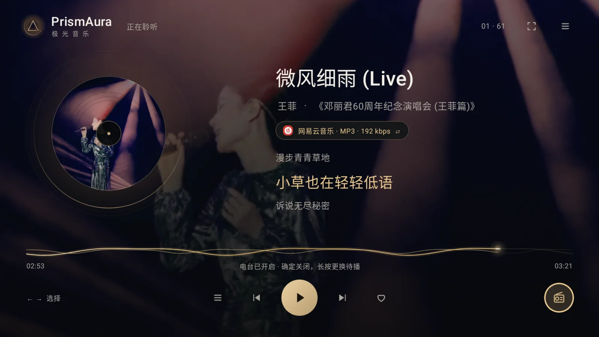

<div align="center">


# 极光音乐 · PrismAura

**为 TV 而生，让音乐成为客厅的主角。**

大屏看封面与歌词，遥控器一键开听。<br>
手机扫码完成输入和管理，把轻松留在手里。

**Android TV 6.0+** · **MusicFree 插件兼容** · **MIT**

[特性](#特性) · [界面预览](#界面预览) · [开始听](#开始听) · [插件接入](docs/PLUGIN_API.md)

<a href="site/images/tv-player.webp"></a>

</div>

## 特性

<table>
  <tr>
    <td width="50%"><strong>开放插件</strong><br>兼容 MusicFree 常用接口，自行选择音源；扩展 MV、扫码登录与热搜。</td>
    <td width="50%"><strong>手机遥控</strong><br>扫码打开 H5，控制播放、搜索和管理音源，无需另装手机 App。</td>
  </tr>
  <tr>
    <td><strong>音乐与 MV</strong><br>同步歌词、翻译、音质选择与回退；插件支持时可播放 MV。</td>
    <td><strong>多主题</strong><br>黑金、瓷白、黑白，支持待机展示和减少动态效果。</td>
  </tr>
  <tr>
    <td><strong>无广告</strong><br>客户端不内置广告 SDK，也不提供广告位。</td>
    <td><strong>本地曲库</strong><br>收藏、历史、歌单导入与备份保存在本机，无内置集中遥测。</td>
  </tr>
</table>

## 界面预览

<table>
  <tr>
    <td width="70%" align="center">
      <strong>发现 · 分类歌单与音乐榜单</strong><br><br>
      <a href="site/images/tv-discover.webp"></a>
    </td>
    <td width="30%" rowspan="2" align="center" valign="middle">
      <strong>手机 H5 · 随手掌控</strong><br><br>
      <a href="site/images/phone-remote.webp"></a><br>
      <sub>同一局域网 · 扫码即用</sub>
    </td>
  </tr>
  <tr>
    <td align="center">
      <strong>扫码登录 · 告别遥控器逐字输入</strong><br><br>
      <a href="site/images/tv-login.webp"></a>
    </td>
  </tr>
</table>

<p align="center"><strong>三种光线，同一种专注</strong></p>

<table>
  <tr>
    <td width="33%" align="center"><strong>极夜暖金</strong><br><br><a href="site/images/theme-gold.webp"></a></td>
    <td width="33%" align="center"><strong>晨光白瓷</strong><br><br><a href="site/images/theme-porcelain.webp"></a></td>
    <td width="33%" align="center"><strong>静谧黑白</strong><br><br><a href="site/images/theme-mono.webp"></a></td>
  </tr>
</table>

## 开始听

需要 **Android 6.0+（API 23）** 和可用的 Android System WebView；运行时兼容 Chrome 66。

1. 安装 APK，在「设置 → 音源」添加自己信任的插件或订阅。
2. 按需配置账号；插件支持时可扫码登录。
3. 搜索歌曲，或从首页开启「极光电台」持续收听；到「发现」挑选分类歌单与榜单。

内容卡片短按确认打开，长按确认或按菜单键查看操作；删除本机歌单会再次确认。
「我的」按歌曲、专辑、歌手、歌单、最近分类；导入入口在歌单工具栏。播放器的收音机图标可直接开启／关闭电台，长按调整待播。

客户端**不附带平台插件、订阅地址或音乐内容**。功能与播放权限由所装插件和对应服务决定。截图为界面演示，二维码不能用于实际登录。配置和备份可能包含凭据，详见 [安全说明](SECURITY.md)。

## 开发说明

本项目采用 Vibe Coding，开发过程中使用了 AI 辅助。代码、文档及功能描述可能存在错误或遗漏，不能保证完全正确；欢迎通过 Issue 或贡献指出问题。

## 构建与接入

使用 JDK 17、Android SDK 34：

```sh
./gradlew :app:assembleDebug
```

APK：`app/build/outputs/apk/debug/app-debug.apk`。release 沿用已有 APK 的签名，支持覆盖升级；推送版本标签可自动发布 APK 和更新说明，详见 [发布指南](docs/DEVELOPMENT.md#github-自动发布)。

[插件 API 与能力矩阵](docs/PLUGIN_API.md) · [TypeScript 接口](docs/plugin-api.d.ts) · [开发指南](docs/DEVELOPMENT.md) · [架构](docs/ARCHITECTURE.md) · [贡献](CONTRIBUTING.md)

## 许可与致谢

客户端采用 [MIT](LICENSE)。感谢 [MusicFree](https://github.com/maotoumao/MusicFree) 的插件协议与生态，以及 Compose for TV、Media3 等开源项目。第三方依赖保留各自的版权与许可，参见 [依赖声明](app/src/main/assets/THIRD_PARTY_NOTICES.txt)。

