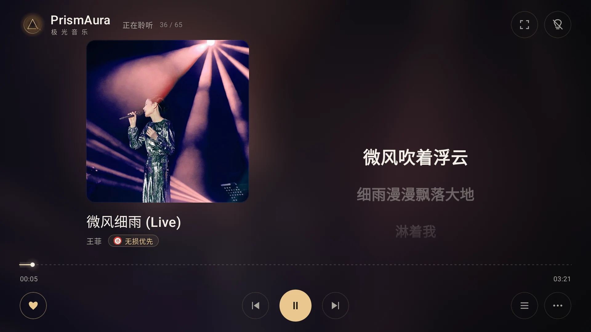
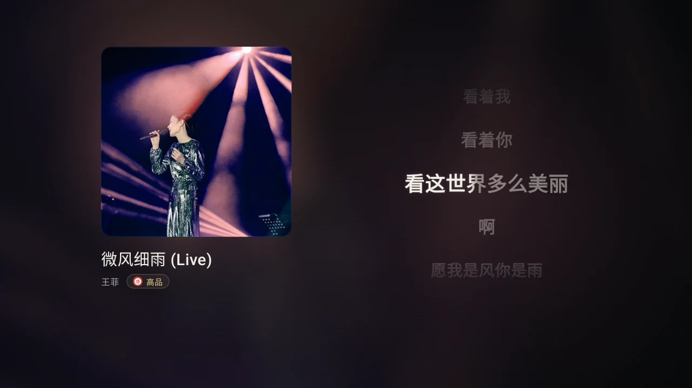
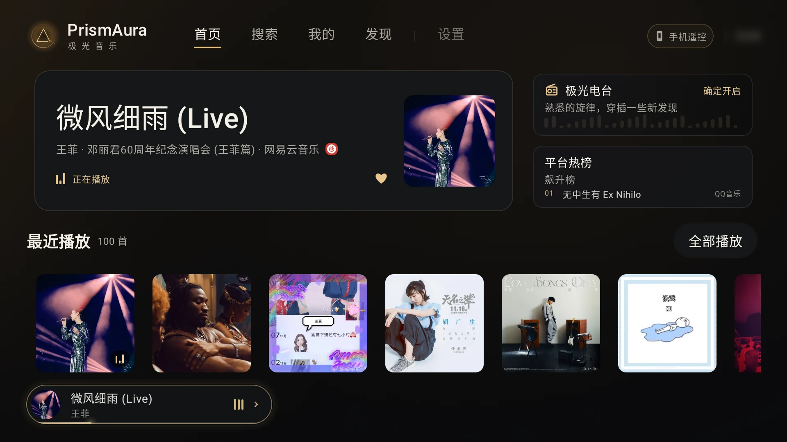
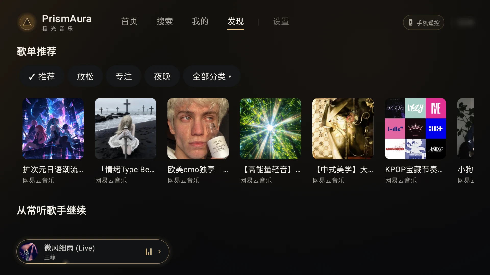
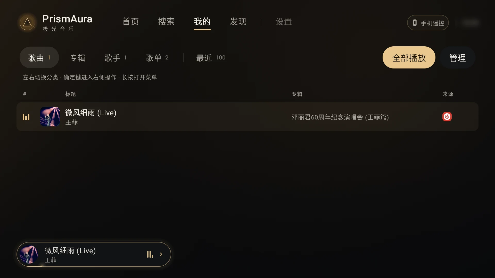
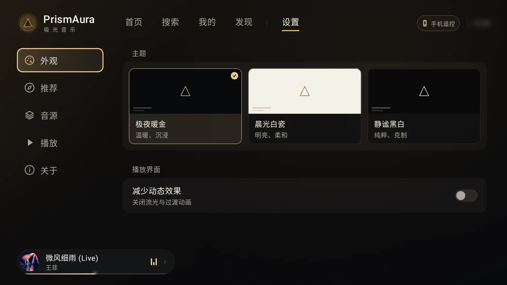
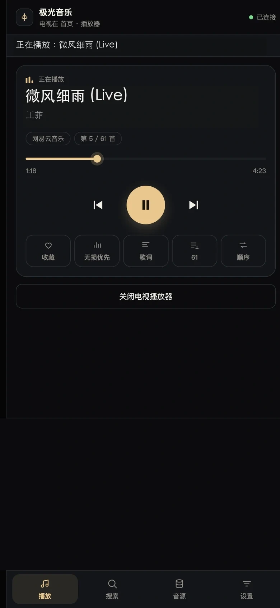
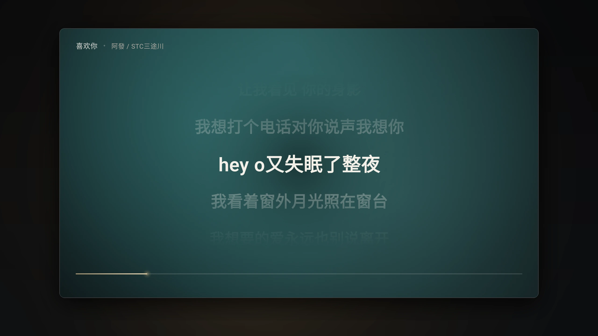
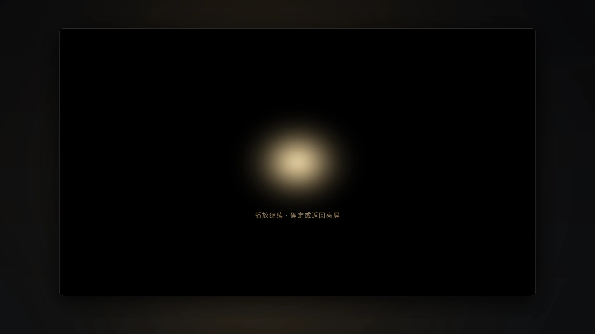

<div align="center">


# 极光音乐 · PrismAura

**为 TV 而生，让音乐成为客厅的主角。**

大屏看封面与歌词，遥控器一键开听。<br>
手机扫码完成输入和管理，把轻松留在手里。

<p align="center">
  <a href="https://github.com/shellvon/prismaura-tv/releases/latest"></a>
  &nbsp;
  <a href="https://github.com/shellvon/prismaura-tv/releases"></a>
  &nbsp;
  <a href="https://github.com/shellvon/prismaura-tv/commits/main/"></a>
  &nbsp;
  <a href="LICENSE"></a>
  &nbsp;
  
  &nbsp;
  <a href="docs/PLUGIN_API.md"></a>
</p>

[官网](https://tv-music.240524.xyz/) · [特性](#特性) · [遥控操作](#遥控操作) · [界面预览](#界面预览) · [开始听](#开始听) · [插件接入](docs/PLUGIN_API.md)

</div>

## 特性

- 📺 **用遥控器，舒服地选歌**：方向键浏览，按确定打开或播放；选中歌曲、歌手、专辑或歌单后，长按确定键或按菜单键，查看对应操作。
- 📱 **告别遥控器逐字输入**：同一局域网扫码，用手机搜索、管理音源与播放队列，调整播放、歌词和主题偏好，还能备份与恢复，无需另装手机 App。
- 🎤 **歌词跟着音乐走**：插件提供歌词时显示原文、翻译或注音；返回词级时间戳时逐字高亮，否则按句同步滚动。播放页可调字号、歌词显示和时间校准，也能进入沉浸模式。
- 💡 **熄屏播放**：纯黑画面继续播放，音量和媒体键照常操作，按确定或返回恢复画面；不保证关闭电视背光。
- 🎨 **三套外观主题**：极夜暖金、晨光白瓷、静谧黑白；只改变界面配色，不会滤镜化封面图片。
- 📻 **不想选歌，就交给极光电台**：混播收藏、最近播放和音源提供的推荐／榜单曲目，自动续曲，在熟悉的歌里穿插新发现。
- 🔎 **多个音源，一处搜索**：搜索全部或选定音源，热搜建议随手点；插件支持时，可导入单曲或歌单链接为本机歌单，暂不支持导入歌手。
- 🔌 **沿用 MusicFree 插件生态**：兼容常用插件接口，按需安装你信任的插件或订阅；推荐、榜单、歌词和内容导入由插件提供。平台扫码登录需要插件实现对应接口；手机遥控二维码则由客户端生成。支持音质选择和不可用时降档，也可开启播放失败自动换源（默认关闭）。

客户端不内置广告 SDK，也不提供广告位。收藏、历史和歌单保存在本机，不配置集中遥测或崩溃上报；联网行为限于插件请求、局域网手机遥控与版本更新检查，详见 [安全说明](SECURITY.md)。


## 遥控操作

**选中内容后，长按确定键，或按遥控器菜单键，打开操作菜单。** 可用操作随内容类型和音源能力变化。

| 选中位置 | 可用操作示例 |
| --- | --- |
| 歌曲或播放队列中的歌曲 | 播放、收藏，进入歌手／专辑详情；在最近播放或本机歌单中还可删除记录或移出歌单 |
| 歌手、专辑或歌单卡片 | 查看详情、收藏，或删除本机歌单 |
| 播放页「⋯ → 极光电台」 | 开启或关闭电台 |

「我的」页用左右键切换分类，按确定进入右侧操作区，按下浏览内容。

播放页「⋯」提供音质、播放模式、电台和歌词设置，列表按钮打开队列。点击单曲会加入并播放，保留原队列；「播放全部」替换队列，队列中的歌曲可长按移除。

沉浸模式下，确定键播放／暂停，左右键快退／快进 10 秒，返回键退出。关灯播放后，确定或返回可唤醒画面。

> 还没装 App 也可以先看：[官网](https://tv-music.240524.xyz/)提供逐字歌词实录和首页、发现、收藏、设置、手机遥控等界面预览；录屏不播放真实音频。

## 界面预览

<a href="site/images/experience-player.webp"></a>

<p align="center"><sub>电视播放页截图 · 王菲《微风细雨（Live）》</sub></p>

<a href="site/media/lyrics-yrc-demo.webm"></a>

<p align="center"><sub>逐字歌词实录 · 网易音源返回 YRC 词级时间戳；逐字效果取决于插件是否提供词级数据，格式与精度因音源而异</sub></p>

<table>
  <tr>
    <td width="50%" align="center">
      <strong>首页 · 接着听与最近播放</strong><br><br>
      <a href="site/images/experience-home.webp"></a>
    </td>
    <td width="50%" align="center">
      <strong>发现 · 歌单与音乐榜单</strong><br><br>
      <a href="site/images/experience-discover.webp"></a>
    </td>
  </tr>
  <tr>
    <td align="center">
      <strong>收藏与最近 · 本机音乐分区管理</strong><br><br>
      <a href="site/images/experience-library.webp"></a>
    </td>
    <td align="center">
      <strong>设置 · 主题与播放偏好</strong><br><br>
      <a href="site/images/experience-settings.webp"></a>
    </td>
  </tr>
</table>

<table>
  <tr>
    <td width="50%" align="center">
      <strong>手机遥控 · 手机输入与播放控制</strong><br><br>
      <a href="site/images/experience-phone.webp"></a>
    </td>
    <td width="50%" align="center">
      <strong>扫码连接 · 截图中的二维码不可用</strong><br><br>
      <a href="site/images/experience-qr.webp"></a>
    </td>
  </tr>
  <tr>
    <td width="50%" align="center">
      <strong>沉浸播放 · 全屏歌词与封面氛围</strong><br><br>
      <a href="site/images/preview-immersive.webp"></a>
    </td>
    <td width="50%" align="center">
      <strong>关灯播放 · 屏幕渐暗，音乐继续</strong><br><br>
      <a href="site/images/preview-screen-off.webp"></a>
    </td>
  </tr>
</table>

<p align="center"><sub>界面截自 Android TV 模拟器；手机页面为界面预览。截图中的手机遥控二维码不能用于连接。</sub></p>

## 开始听

需要 **Android 6.0+（API 23）** 和可用的 Android System WebView；运行时兼容 Chrome 66。

1. 安装 APK，在「设置 → 音源」添加自己信任的插件或订阅。
2. 按需配置账号；插件支持时可扫码登录。
3. 搜索歌曲，或从首页开启「极光电台」持续收听；到「发现」挑选分类歌单与榜单。

「我的」按歌曲、专辑、歌手、歌单、最近分类；导入入口在歌单分类右侧，可导入插件支持的歌单或单曲链接，暂不支持导入歌手。单曲会保存为只有一首歌的本机歌单。收藏、历史与导入的歌单保存在本机；删除本机歌单会再次确认。

> [!TIP]
> 本仓库与客户端**不附带平台插件、订阅地址或音乐内容**。请自行添加信任的音源；功能与播放权限由所装插件和对应服务决定。

截图为界面演示，二维码不能用于实际登录。配置和备份可能包含凭据，详见 [安全说明](SECURITY.md)。

## 常见问题

<details>
<summary>为什么安装后没有歌曲？</summary>

PrismAura 不附带音源。在「设置 → 音源」添加自己信任的插件或订阅后，再搜索歌曲或浏览歌单。可以用手机扫码粘贴地址，或在手机音源页选择本地 `.js` 文件；接入范围见 [插件 API 与能力矩阵](docs/PLUGIN_API.md)。

</details>

<details>
<summary>为什么搜到了歌曲，却无法播放？</summary>

搜索结果不代表一定可播放，实际取决于插件、内容服务、账号权限和网络。先检查插件是否有更新，并按插件要求完成配置；需要登录的内容，应使用自己的账号。

「设置 → 播放」可开启“播放失败自动换源”（默认关闭）：本源所有音质均不可用时，尝试其他已启用音源的同版本歌曲；仍失败时沿用自动跳歌流程。该开关随备份导出和恢复。

</details>

<details>
<summary>更新需要卸载旧版本吗？</summary>

不需要。使用相同包名、相同签名且版本更高的安装包覆盖升级，可以保留现有应用数据；也可在「设置 → 关于」检查更新。自行构建时需要沿用原签名，见 [签名与覆盖更新](docs/DEVELOPMENT.md#签名与覆盖更新)。

</details>

## 开发说明

本项目采用 Vibe Coding，开发过程中使用了 AI 辅助。代码、文档及功能描述可能存在错误或遗漏，不能保证完全正确；欢迎通过 Issue 或贡献指出问题。

## 构建与接入

使用 JDK 17、Android SDK 34：

```sh
./gradlew :app:assembleDebug
```

APK：`app/build/outputs/apk/debug/app-debug.apk`。release 沿用已有 APK 的签名，支持覆盖升级；推送版本标签可自动发布 APK 和更新说明，详见 [发布指南](docs/DEVELOPMENT.md#github-自动发布)。

[插件 API 与能力矩阵](docs/PLUGIN_API.md) · [TypeScript 接口](docs/plugin-api.d.ts) · [开发指南](docs/DEVELOPMENT.md) · [架构](docs/ARCHITECTURE.md) · [贡献](CONTRIBUTING.md)

## 许可与致谢

客户端采用 [MIT](LICENSE)。感谢 [MusicFree](https://github.com/maotoumao/MusicFree) 的插件协议与生态，以及 Compose for TV、Media3 等开源项目。第三方依赖保留各自的版权与许可，参见 [依赖声明](app/src/main/assets/THIRD_PARTY_NOTICES.txt)。

