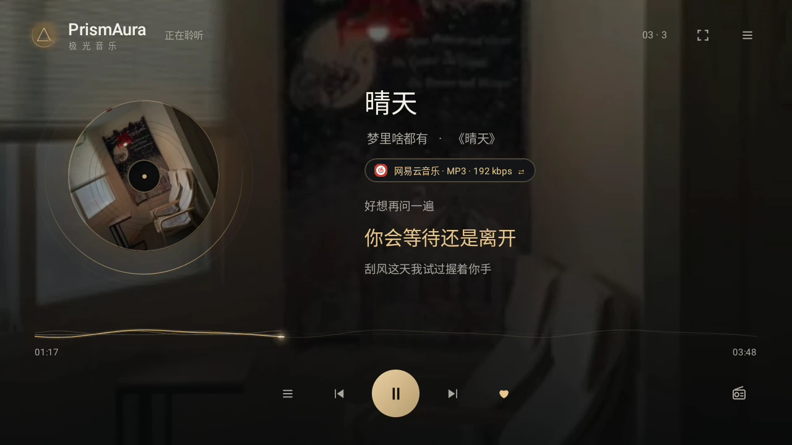
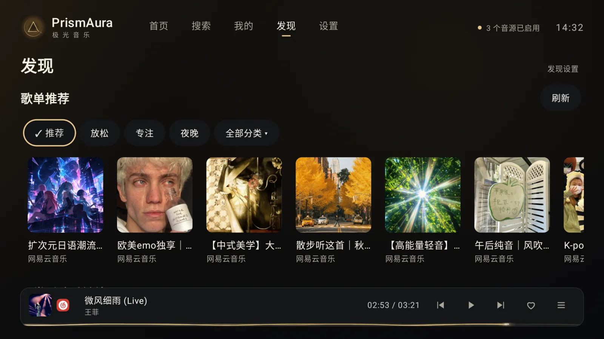
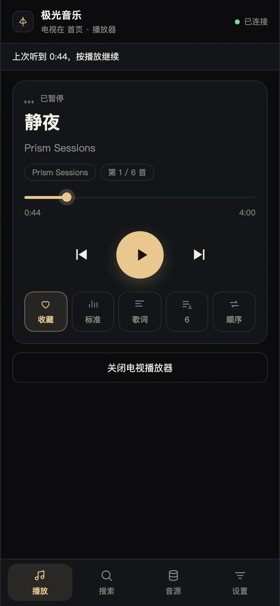
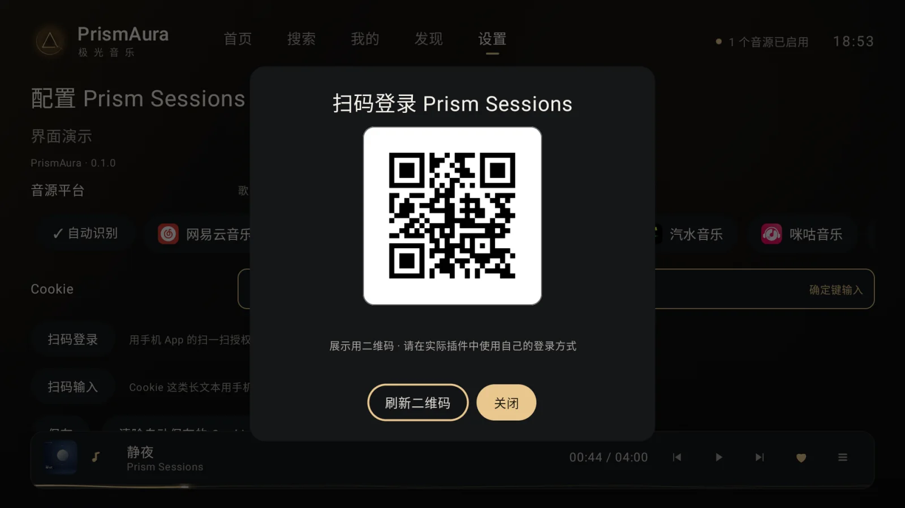
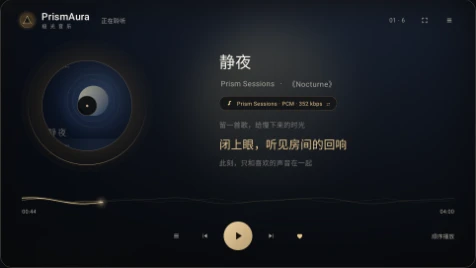
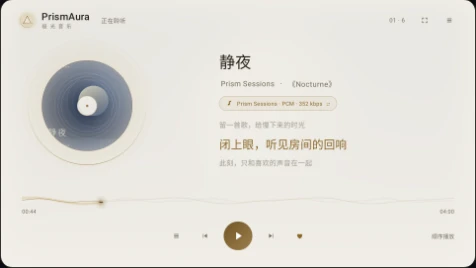
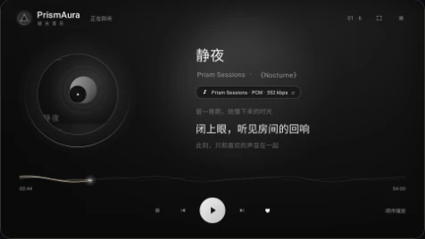

<div align="center">


# 极光音乐 · PrismAura

**为 TV 而生，让音乐成为客厅的主角。**

大屏看封面与歌词，遥控器一键开听。<br>
手机扫码完成输入和管理，把轻松留在手里。

**Android TV 6.0+** · **MusicFree 插件兼容** · **MIT**

<p align="center">
  <a href="https://github.com/shellvon/prismaura-tv/releases/latest"></a>
  &nbsp;
  <a href="https://github.com/shellvon/prismaura-tv/releases"></a>
  &nbsp;
  <a href="https://github.com/shellvon/prismaura-tv/commits/main/"></a>
</p>

[官网](https://tv-music.240524.xyz/) · [特性](#特性) · [界面预览](#界面预览) · [开始听](#开始听) · [插件接入](docs/PLUGIN_API.md)

<a href="https://tv-music.240524.xyz/#demo"></a>

<a href="https://tv-music.240524.xyz/#demo">→ 观看演示</a>

</div>

## 特性

- 📺 **用遥控器，舒服地选歌**：方向键浏览、确认键播放，长按或菜单键管理内容，选歌、切歌和收藏都能在沙发上完成。
- 📱 **告别遥控器逐字输入**：同一局域网扫码，用手机搜索、粘贴音源地址、管理播放队列，还能备份与恢复，无需另装手机 App。
- 🌙 **大屏看歌词，也能安静听歌**：同步歌词与翻译，极夜暖金、晨光白瓷、静谧黑白三套主题；开启待机模式，收起操作按钮，只留下封面、歌词和进度。
- 📻 **不想选歌，就交给极光电台**：混播收藏、最近播放和音源提供的推荐／榜单曲目，自动续曲，在熟悉的歌里穿插新发现。
- 🔎 **多个音源，一处搜索**：搜索全部或选定音源，热搜建议随手点；插件支持时，可粘贴歌曲、歌单链接导入为本机歌单。
- 🔌 **沿用 MusicFree 插件生态**：兼容 MusicFree 常用插件接口，按需安装你信任的插件或订阅；推荐、榜单由插件提供，扫码登录、热搜与 MV 是客户端扩展；支持音质选择与不可用时回退。

客户端不内置广告 SDK，也不提供广告位。收藏、历史和歌单保存在本机，不配置集中遥测或崩溃上报；联网行为限于插件请求、局域网手机遥控与版本更新检查，详见 [安全说明](SECURITY.md)。


## 界面预览

<table>
  <tr>
    <td width="70%" align="center">
      <strong>发现 · 分类歌单与音乐榜单</strong><br><br>
      <a href="site/images/tv-discover.webp"></a>
    </td>
    <td width="30%" rowspan="2" align="center" valign="middle">
      <strong>手机 H5 · 随手掌控</strong><br><br>
      <a href="site/images/phone-remote.webp"></a><br>
      <sub>同一局域网 · 扫码即用</sub>
    </td>
  </tr>
  <tr>
    <td align="center">
      <strong>扫码登录 · 告别遥控器逐字输入</strong><br><br>
      <a href="site/images/tv-login.webp"></a>
    </td>
  </tr>
</table>

<p align="center"><strong>三种光线，同一种专注</strong></p>

<table>
  <tr>
    <td width="33%" align="center"><strong>极夜暖金</strong><br><br><a href="site/images/theme-gold.webp"></a></td>
    <td width="33%" align="center"><strong>晨光白瓷</strong><br><br><a href="site/images/theme-porcelain.webp"></a></td>
    <td width="33%" align="center"><strong>静谧黑白</strong><br><br><a href="site/images/theme-mono.webp"></a></td>
  </tr>
</table>

## 开始听

需要 **Android 6.0+（API 23）** 和可用的 Android System WebView；运行时兼容 Chrome 66。

1. 安装 APK，在「设置 → 音源」添加自己信任的插件或订阅。
2. 按需配置账号；插件支持时可扫码登录。
3. 搜索歌曲，或从首页开启「极光电台」持续收听；到「发现」挑选分类歌单与榜单。

内容卡片短按确认打开，长按确认或按菜单键查看操作；删除本机歌单会再次确认。
「我的」按歌曲、专辑、歌手、歌单、最近分类；导入入口在歌单工具栏。播放器的收音机图标可直接开启／关闭电台，长按调整待播。

> [!TIP]
> 本仓库与客户端**不附带平台插件、订阅地址或音乐内容**。请自行添加信任的音源；功能与播放权限由所装插件和对应服务决定。

截图为界面演示，二维码不能用于实际登录。配置和备份可能包含凭据，详见 [安全说明](SECURITY.md)。

## 常见问题

<details>
<summary>为什么安装后没有歌曲？</summary>

PrismAura 不附带音源。在「设置 → 音源」添加自己信任的插件或订阅后，再搜索歌曲或浏览歌单。可以用手机扫码粘贴地址；接入范围见 [插件 API 与能力矩阵](docs/PLUGIN_API.md)。

</details>

<details>
<summary>为什么搜到了歌曲，却无法播放？</summary>

搜索结果不代表一定可播放，实际取决于插件、内容服务、账号权限和网络。先检查插件是否有更新，并按插件要求完成配置；需要登录的内容，应使用自己的账号。

</details>

<details>
<summary>更新需要卸载旧版本吗？</summary>

不需要。使用相同包名、相同签名且版本更高的安装包覆盖升级，可以保留现有应用数据；也可在「设置 → 关于」检查更新。自行构建时需要沿用原签名，见 [签名与覆盖更新](docs/DEVELOPMENT.md#签名与覆盖更新)。

</details>

## 开发说明

本项目采用 Vibe Coding，开发过程中使用了 AI 辅助。代码、文档及功能描述可能存在错误或遗漏，不能保证完全正确；欢迎通过 Issue 或贡献指出问题。

## 构建与接入

使用 JDK 17、Android SDK 34：

```sh
./gradlew :app:assembleDebug
```

APK：`app/build/outputs/apk/debug/app-debug.apk`。release 沿用已有 APK 的签名，支持覆盖升级；推送版本标签可自动发布 APK 和更新说明，详见 [发布指南](docs/DEVELOPMENT.md#github-自动发布)。

[插件 API 与能力矩阵](docs/PLUGIN_API.md) · [TypeScript 接口](docs/plugin-api.d.ts) · [开发指南](docs/DEVELOPMENT.md) · [架构](docs/ARCHITECTURE.md) · [贡献](CONTRIBUTING.md)

## 许可与致谢

客户端采用 [MIT](LICENSE)。感谢 [MusicFree](https://github.com/maotoumao/MusicFree) 的插件协议与生态，以及 Compose for TV、Media3 等开源项目。第三方依赖保留各自的版权与许可，参见 [依赖声明](app/src/main/assets/THIRD_PARTY_NOTICES.txt)。

