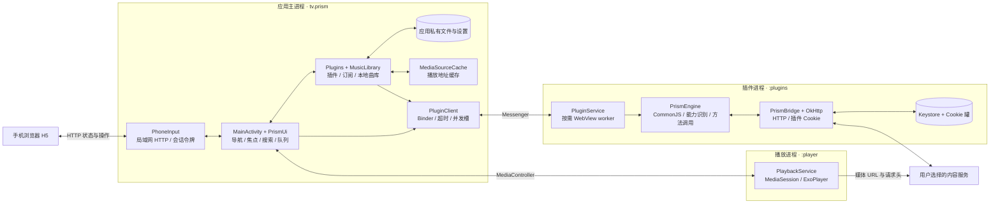
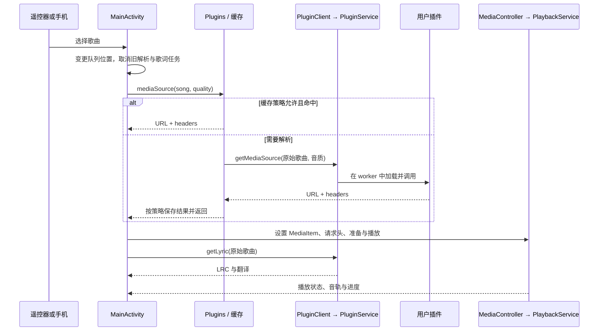

# 架构与代码入口

本文面向维护客户端、扩展插件宿主或接手代码的贡献者。核心原则是：**TV 与手机共用业务状态，插件解释内容，播放器负责媒体执行。**

## 进程与职责

主界面、插件执行与音频播放分进程，降低单个解码器或插件异常对其它部分的影响；这不等于把插件放进独立 Android UID 的安全沙箱。MV 由界面侧的 `MvPlayer` 播放，进入／退出时协调音频暂停与恢复。

## 一次播放如何完成

音质不可用时由界面编排回退档位。单曲解析失败时按当前失败集合跳过，整轮均失败则停止尝试，避免无限切歌。内容地址和鉴权仍由插件与服务决定。

## 状态由谁拥有

| 状态／规则 | 所有者 | 修改入口 |
| --- | --- | --- |
| 页面、详情返回栈、焦点 | MainActivity / PrismUi | 遥控器与页面动作 |
| 搜索条件、结果与分页 | MainActivity | 电视和 H5 共用的搜索入口 |
| 队列、下一首、播放模式 | MainActivity | 播放控制、媒体状态回调 |
| 音频执行与 MediaSession | PlaybackService | MediaController |
| 插件源码、元数据、配置、归属 | Plugins | 导入、更新、启停、配置、恢复 |
| 收藏、历史、本机歌单与实体 | MusicLibrary | 原子文件写入的变更方法 |
| 播放地址缓存 | MediaSourceCache | Plugins.mediaSource 按 cacheControl 访问 |
| 榜单预览、搜索热门建议 | MainActivity | 榜单保留单个音源快照 15 分钟；热搜逐源显示并在 Activity 内短期复用 |
| 上次队列与位置 | ResumeStore | 定期保存与 onStop 保存；最多 300 首的当前窗口 |
| 自动 Cookie | PluginCookies，插件进程内使用 | 原生 HTTP CookieJar 与 Cookie 模块 |
| 手机会话 | PhoneInput + Activity 生命周期 | 开启、隐藏二维码、结束、到期／onStop |

队列推进仍属于界面进程。因此音频服务存活不代表界面进程被结束后仍会自动切歌；这是目前的生命周期边界。恢复快照用于下次启动恢复位置，不是服务端队列副本。

## 数据约定与兼容

- 曲库保留插件的原始 JSON；UI 展示模型不能裁掉后续方法所需的私有字段。
- 本机插件 ID 维护来源关联，`primaryKey` 决定同一插件内实体标识。默认 id 保留旧标识格式，复合字段按字段名和值编码并持久化。
- 元数据变化后更新已有记录的主键声明，避免重新搜索后收藏出现两套身份。插件移除后保留曲库，同地址重新导入尝试复用原插件 ID。
- 插件与曲库使用 AtomicFile。备份格式目前是 format 1；恢复是覆盖，不是合并，也不是跨多个文件的完整事务。
- 自动 Cookie 罐加密且按插件隔离；用户变量、备份和解析缓存另有数据边界，见 [安全说明](../SECURITY.md)。

## 代码导航

| 路径 | 首先看什么 |
| --- | --- |
| [MainActivity.kt](../app/src/main/java/tv/prism/MainActivity.kt) | search、playAt、importPlaylist、loadBrowse、手机 snapshot/command、Screen |
| [PrismUi.kt](../app/src/main/java/tv/prism/PrismUi.kt) | 主题、焦点装饰、唱片与歌词、列表和卡片 |
| [AppUpdates.kt](../app/src/main/java/tv/prism/AppUpdates.kt) / [UpdateUi.kt](../app/src/main/java/tv/prism/UpdateUi.kt) | 客户端更新、网络回退、安装验证与遥控器更新弹窗 |
| [Discovery.kt](../app/src/main/java/tv/prism/Discovery.kt) | 能力模型、按能力选源、常听歌手、场景与电台编排规则 |
| [Plugins.kt](../app/src/main/java/tv/prism/Plugins.kt) | 插件导入、srcUrl 更新、版本保护、订阅归属、mediaSource |
| [PluginClient.kt](../app/src/main/java/tv/prism/PluginClient.kt) | Binder 连接、调用 ID、超时、取消、并发预算 |
| [PluginService.kt](../app/src/main/java/tv/prism/PluginService.kt) | WebView worker、原生 HTTP 与 Cookie 桥 |
| [runtime.js](../tools/plugin-runtime/runtime.js) | 可 require 的模块、元数据、fetch/axios 适配、方法调用 |
| [MusicLibrary.kt](../app/src/main/java/tv/prism/MusicLibrary.kt) | 实体标识、曲库结构、主键迁移与原子写入 |
| [MediaSourceCache.kt](../app/src/main/java/tv/prism/MediaSourceCache.kt) | 缓存键、数量和大小边界 |
| [PlaybackService.kt](../app/src/main/java/tv/prism/PlaybackService.kt) | MediaSession、解码器、媒体请求头 |
| [PhoneInput.kt](../app/src/main/java/tv/prism/PhoneInput.kt) | HTTP 解析、令牌、来源检查、主线程分发 |
| [LibraryBackup.kt](../app/src/main/java/tv/prism/LibraryBackup.kt) / [Resume.kt](../app/src/main/java/tv/prism/Resume.kt) | 可迁移数据与短期恢复状态的区别 |

## 变更时要守住的边界

新增 TV 或 H5 动作应调用同一业务入口，不在两个界面各写一套规则。网络、存储与插件协议的校验应留在对应责任层；不要让视觉组件管理 Cookie、源码或文件写入。

插件方法缺失、网络失败和空结果是不同状态。UI 应按能力展示入口，保留原始错误中的可操作信息，同时避免向日志或公开反馈泄漏凭据。涉及协议、缓存或身份的变化需补回归测试，并更新 [插件参考](PLUGIN_API.md)。
